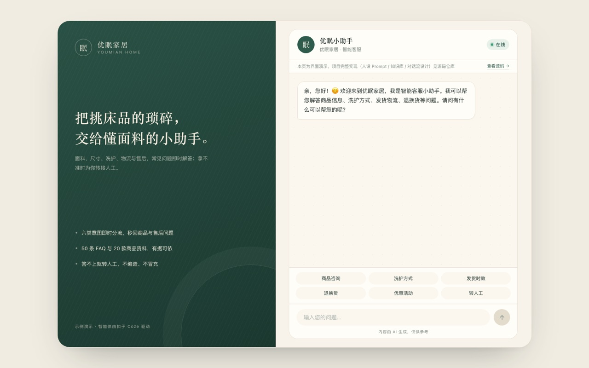
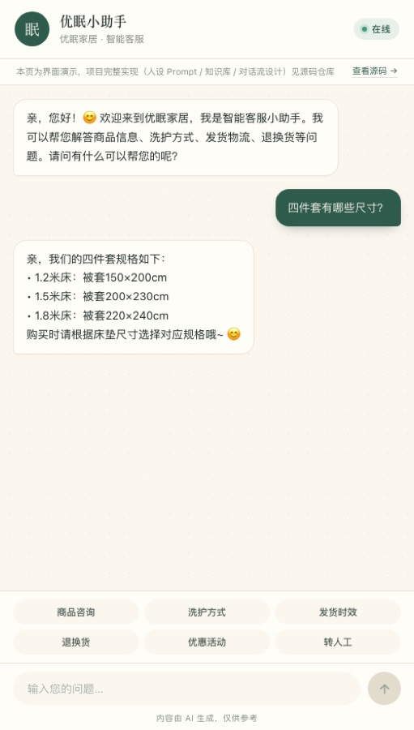
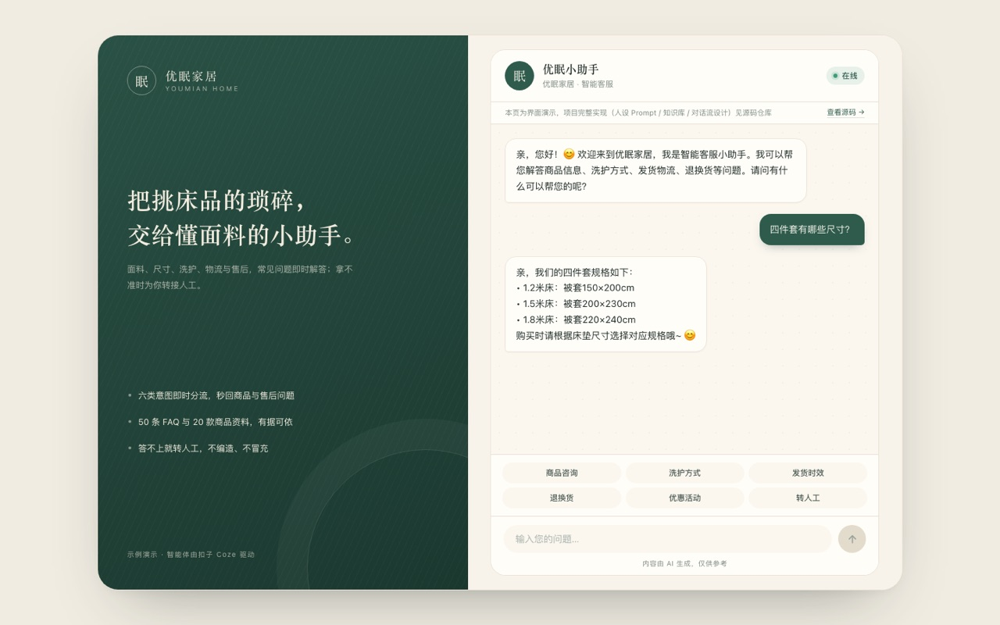

# 电商 AI 智能客服系统 · 优眠小助手

> 基于扣子 Coze 搭建的电商智能客服智能体，通过**六路条件判断对话流**按用户意图路由，结合 FAQ 知识库与商品目录，实现商品咨询、洗护指南、物流发货、退换售后、优惠活动等场景的自动应答。

## 项目链接

- **在线体验（可真实对话）**：[youmian-customer-service.onrender.com](https://youmian-customer-service.onrender.com)
  - 部署在 Render 免费实例上，闲置一段时间后首次访问需等待约 50 秒唤醒
- **源码仓库**：[ecommerce-ai-customer-service](https://github.com/sochikurimareki68-gif/ecommerce-ai-customer-service)
- **静态演示**：[GitHub Pages](https://sochikurimareki68-gif.github.io/ecommerce-ai-customer-service)（纯前端，展示界面与交互，无需后端）
- 演示视频：待补充

> 智能体运行在扣子 Coze 平台，需在扣子账号内搭建使用。本仓库提供完整的人设 Prompt、知识库、对话流设计、评测数据集，可按文档完整复现。

## 界面预览

<p align="center">
  
  
</p>

<p align="center">
  
  <br>
  <sub>桌面端为品牌栏 + 对话双栏，窄屏自动收起品牌栏；快捷提问与引用式回答均为真实交互。</sub>
</p>

## 功能

- **六路意图路由**：选择器节点自带 LLM 意图识别，自动分类并路由到对应分支
- **知识库问答（RAG）**：基于 FAQ 知识库（50条）+ 商品目录（20款）检索回答
- **多轮上下文追问**：意图识别与 6 个回复节点均开启「会话历史」，配合「携带上下文轮数 10」，指代句/省略句（「那纯棉的呢」）可正确续答
- **分级消息处理**：问候语/转人工/结束语直接回复，业务咨询走对话流，异常走安全兜底
- **安全兜底**：无法回答时礼貌引导转人工，不编造答案、不冒充人工客服
- **可在线试用**：经后端代理与真实智能体流式对话，前端不暴露任何密钥
- **可量化评测**：附带 31 条用例的自动化评测脚本，关键信息覆盖率 100%、回复规范性 100%，意图路由人工复核 30/30

## 对话流架构

```
用户输入（USER_INPUT / CONVERSATION_NAME）
   │
   ▼
意图识别（选择器节点，自带 LLM，已开启会话历史）
   │
   ├─ ① 商品咨询 ──→ LLM 节点（技能：FAQ + 商品目录）─→ output
   ├─ ② 洗护指南 ──→ LLM 节点（技能：FAQ + 商品目录）─→ output1
   ├─ ③ 物流发货 ──→ LLM 节点（技能：FAQ + 商品目录）─→ output2
   ├─ ④ 退换售后 ──→ LLM 节点（技能：FAQ + 商品目录）─→ output3
   ├─ ⑤ 优惠活动 ──→ LLM 节点（技能：商品目录 + FAQ）─→ output4
   └─ ⑥ 其他兜底 ──→ LLM 节点（技能：FAQ）────────────→ output5
   │
   ▼
代码节点（合并六路输出为单一 reply，并记录实际走的 branch）
   │
   ▼
结束节点返回 reply + branch（返回变量）
```

> 结束节点用「返回变量」后，API 拿到的是 `{"reply": "...", "branch": "商品咨询"}`。后端代理会拆开：`reply` 照常下发给页面，`branch` 作为真实分类标签单独下发，供评测统计路由准确率（v1.9）。

**为什么用对话流**：客服是典型多轮场景，对话流绑定会话后可读历史消息，且发布渠道更广（API&SDK、小程序、社交渠道等）。工作流与对话流可一键互转。注意「会话记忆」要两层配合才生效：智能体「对话设置」的携带上下文轮数（本项目 10）只定上限，节点自己的「会话历史」开关才是总开关——此前 7 个节点全关，导致多轮追问断裂，v1.7 已全部打开。

**智能体接入方式**：采用「单 Agent（对话流模式）」，每轮对话直接执行绑定的对话流，省去规划层，响应更快；结束节点用「返回变量」输出 `reply` + `branch`，由后端代理拆分后再发给页面，用户看到的仍是纯文本。

## 技术栈

- 平台：扣子 Coze（www.coze.cn）
- 对话流：选择器节点（意图识别）+ 大模型节点 + 代码节点（Python）
- 知识库：RAG 检索增强（文本知识库，按需调用）
- 模型：豆包 2.0 pro
- 前端：HTML / CSS / JavaScript
- 后端：Python 3 标准库（`http.server` + `urllib`，零第三方依赖）
- 部署：GitHub Pages（静态演示）+ 任意 Python 托管平台（真实对话）

## 项目结构

```
ecommerce-ai-customer-service/
├── index.html                  # 前端聊天页面（有后端时真实对话，无后端时降级为界面演示）
├── server.py                   # 轻量后端代理（Python 标准库，零依赖）
├── render.yaml                 # Render 部署蓝图
├── Procfile                    # 通用启动命令（Render / Railway / Heroku 系）
├── requirements.txt            # 声明无第三方依赖
├── .env.example                # 环境变量示例（复制为 .env 并填写令牌）
├── .github/workflows/ci.yml    # CI：语法检查 + 单元测试 + JSON 校验 + 评测脚本 smoke test
├── tests/
│   └── test_server.py          # 后端单元测试（限流 / 会话 / SSE / 防护，39 条）
├── LICENSE                     # MIT 许可
├── eval/
│   ├── dataset.json            # 评测数据集（31 条单轮 + 5 组多轮 + 分支关键词）
│   ├── run_eval.py             # 自动化评测脚本（零依赖；--multi 跑多轮）
│   ├── report.md               # 单轮评测报告（自动生成）
│   └── report-multi.md         # 多轮评测报告（--multi 自动生成）
├── docs/
│   ├── images/                 # README 界面截图
│   ├── prompt-template.md      # 人设 Prompt 模板（7个模块）
│   ├── faq-knowledge-base.md   # FAQ 知识库（50条，6大类）
│   ├── product-catalog.md      # 商品目录与价格表（20款）
│   ├── chatflow-design.md      # 六路条件判断对话流设计
│   ├── test-cases.md           # 测试用例设计（25 组设计 + 5 条边界补充 = 30 条执行）
│   ├── release-checklist.md    # 上线检查清单（发布前 10 项 + 发布后自检 + 事故对照）
│   └── integration-plan-v2.md  # v2.0 对接真实店铺方案（物流/人工/知识库同步）
└── README.md
```

## 本地运行（真实对话）

前端不保存任何令牌；令牌只存在服务端 `.env` 里，由后端代理转发请求。

```bash
# 1. 配置令牌（pat_ 开头，需勾选 Chat 权限）
cp .env.example .env        # 然后编辑 .env，填入 COZE_API_TOKEN

# 2. 启动服务（零第三方依赖，只用 Python 标准库）
python3 server.py

# 3. 打开页面（macOS 用 open；Windows 用 start；Linux 用 xdg-open）
open http://localhost:3000       # macOS
# start http://localhost:3000    # Windows
# xdg-open http://localhost:3000 # Linux
```

`server.py` 同时承担两件事：托管静态页面 + 提供 `POST /api/chat` 流式转发扣子接口。
另有 `POST /api/reset`：清空当前会话（丢弃 `conversation_id` 并让会话世代 +1），供页面右上角「清空对话」使用。
`GET /api/health` 单独限流（默认单 IP 每分钟 30 次），不占提问额度，供前端重连与后续定时探活使用。
页面加载时会探测 `/api/health`——探测成功走真实对话，失败（例如部署在 GitHub Pages）则自动降级为内置模拟回复的界面演示。

### 为什么需要后端代理

扣子 API 调用需要携带个人访问令牌（PAT）。如果把令牌写进网页源码，任何访客打开开发者工具都能抄走，
等于把账号交出去。所以令牌只放在服务端，浏览器只与本服务通信。

> 想让别人在线试用，把本仓库部署到任意支持 Python 的托管平台（如 Render / Railway / Fly.io），
> 在平台的环境变量中配置 `COZE_API_TOKEN` 即可。GitHub Pages 只能托管静态文件，跑不了后端。

### 可配置环境变量

所有参数都有默认值，通常只需填 `COZE_API_TOKEN`。需要调参时覆盖即可：

| 变量 | 默认值 | 说明 |
|------|--------|------|
| `COZE_API_TOKEN` | （空） | 扣子个人访问令牌，必填 |
| `COZE_BOT_ID` | `7694865098007035940` | 智能体 ID |
| `COZE_API_BASE` | `https://api.coze.cn` | 接口域名（国际版用 `https://api.coze.com`） |
| `PORT` / `HOST` | `3000` / `0.0.0.0` | 监听端口与地址 |
| `MAX_BODY_BYTES` | `4096` | 单次请求体上限（字节） |
| `MAX_MESSAGE_CHARS` | `500` | 单条消息最大字符数 |
| `IP_PER_MINUTE` | `6` | 单 IP 每分钟提问上限 |
| `IP_PER_DAY` | `60` | 单 IP 每天提问上限 |
| `GLOBAL_PER_DAY` | `500` | 全站每日提问总量上限（兜底止损） |
| `HEALTH_PER_MINUTE` | `30` | 单 IP 每分钟 `/api/health` 上限（独立计数，不占提问额度） |
| `ALLOWED_ORIGINS` | （空） | 额外允许的来源域名，逗号分隔 |
| `COZE_CA_BUNDLE` | （空） | 自定义 CA 证书路径；本地证书校验失败（certificate verify failed）时手动指定 |
| `COOKIE_SECURE` | （空） | 强制给会话 Cookie 加 `Secure`（`1`/`true`/`yes`）；留空则按请求的 `X-Forwarded-Proto` 自动判断（HTTPS 部署自动加，本地不加） |

## 部署到公网（让别人能访问）

GitHub Pages 只能托管静态文件，跑不了后端，所以**真实对话必须部署到支持 Python 的平台**。
下面以 Render 为例（免费、步骤最少，仓库里已经放好 `render.yaml`）。

### 方式一：Render（推荐）

1. 把本仓库推送到 GitHub（`.env` 已被 `.gitignore` 忽略，不会被提交）
2. 打开 [dashboard.render.com](https://dashboard.render.com) → **New** → **Blueprint**
3. 选择本仓库，Render 会自动读取根目录的 `render.yaml`
4. 在弹出的环境变量处填写 `COZE_API_TOKEN`（`pat_` 开头，需勾选 Chat 权限）
5. 点 **Apply**，等待首次构建完成（约 2-3 分钟）
6. 得到形如 `https://youmian-customer-service.onrender.com` 的地址——把它发给别人即可直接对话

注意事项：

- **自动部署**：仓库已连接 Render 的 GitHub App，向 `main` 分支推送后会自动构建并部署（约 40–60 秒）
- **免费版会休眠**：15 分钟无访问后实例休眠，下次访问需要约 1 分钟唤醒。面试前先自己打开预热一次
- **区域**：`render.yaml` 里设了 `singapore`（离国内最近）。若提示区域不可用，删掉那一行用默认区域即可
- **令牌安全**：只填在 Render 控制台的 Environment 里，永远不要写进代码或提交到仓库

### 方式二：其他平台

本项目没有第三方依赖、启动命令固定，任何能跑 Python 的平台都能部署：

| 平台 | 启动命令 | 必须配置 |
|------|---------|---------|
| Render | `python server.py` | `COZE_API_TOKEN` |
| Railway | 同左（已提供 `Procfile`，可自动识别） | `COZE_API_TOKEN` |
| Fly.io | 同左 | `COZE_API_TOKEN` |
| 阿里云函数计算 / 腾讯云 CloudBase | 同左 | `COZE_API_TOKEN` |

通用要求只有三条：

1. 启动命令 `python server.py`
2. 监听端口读环境变量 `PORT`（`server.py` 已支持），绑定 `0.0.0.0`（默认已是）
3. 环境变量里配置 `COZE_API_TOKEN`，可选 `COZE_BOT_ID` / `COZE_API_BASE`

### 部署后自检

打开 `https://你的域名/api/health`，应返回：

```json
{"ok": true, "bot_id": "7694865098007035940", "api_base": "https://api.coze.cn", "token_ready": true, "version": "YoumianProxy/1.9"}
```

`token_ready` 为 `false` 说明环境变量没配上；`version` 可以用来确认这次部署的代码是否真的上线；`ok` 都拿不到说明服务没起来。

### 每次发布前照清单走

改动对话流、提示词、知识库或后端代码后，按 [`docs/release-checklist.md`](docs/release-checklist.md) 逐条勾选：
工作流已发布 / 智能体已发布 / API 渠道勾选 / 令牌真的可用 / 单轮与多轮评测通过 / 额度充足 / 密钥未进仓库 / 版本号与文档已更新 / 回滚点已记。
清单里还附了发布后 4 条自检命令和「现象 → 原因 → 处理」对照表。

### GitHub Pages 静态演示仍然有效

部署后端**不影响**原来的 GitHub Pages 页面——同一个 `index.html` 会先探测 `/api/health`：
探到后端就走真实对话，探不到就自动降级为内置模拟回复的界面演示。所以两处可以同时存在。

## 单元测试

后端逻辑（限流、会话存储、来源校验、SSE 翻译、路径穿越）全部有离线测试，不调用扣子接口：

```bash
python3 -m unittest discover -s tests -t . -v
```

共 44 条，CI 每次推送都会执行。

## 效果评测（v1.7）

用 `eval/` 下的数据集与脚本对智能体做自动化回归，量化意图路由与回复质量。

**最新一次评测**（31 条用例 · 2026-10-22 · 线上接口）：

| 指标 | 结果 | 目标 |
|------|------|------|
| 关键信息覆盖率 | **100%**（31/31） | ≥ 95% ✅ |
| 回复规范性 | 100%（31/31，无冒充人工 / 无 XML 标签 / 无代码块） | 100% ✅ |
| 意图路由（关键词反推） | 80.6%（25/31） | ≥ 96.7% ⚠️ 见下 |
| 平均响应延迟 | 23.3s（P95 36.0s，最长 45.9s） | — |
| 平均首字时间（TTFT） | 23.3s（P95 36.0s） | — |
| 首字后收尾耗时 | **0.02s**（31 条中 30 条 ≤ 0.1s，最大 0.3s） | — |

「首字后收尾耗时」= 总耗时 − 首字时间。31 条里有 30 条不超过 0.1 秒，说明回复是**一次性整段到达**，用户在整个等待期间看不到任何文字——这不是测量误差，而是「代码节点收齐六路输出后才产出完整字符串」的结构性结果。因此优化延迟的正确方向是压缩首字之前的前置链路（意图识别 → 技能检索 → 生成），而不是加快“打字”。完整逐条数据见 `eval/report.md` 第四章「延迟分解」。

**6 条「路由不符」已逐条人工复核，实际全部落在预期分支（30/30）**：F03 转人工、L03 包邮、P04 推荐、R05 投诉、W02 洗护频次、W05 晾晒，回复内容与关键信息均正确。误判出在「关键词反推」这一层——v1.7 的提示词在结尾追问"材质"、转人工改用"已收到您的转人工需求"，把打分带偏（L03/P04/W05 为并列判「歧义」，F03/R05 为未命中判「未识别」）。完整复核表见 `eval/report.md` 第四章。

> **v1.9 起改用真实标签**：代码节点按「六路里哪一路输出了非空内容」直接给出 `branch`，结束节点以「返回变量」输出 `reply` + `branch`，代理拆开后 `branch` 通过独立 SSE 事件下发，评测优先使用它。线上抽查 5 条覆盖五个分支全部命中；31 条全量重跑待当日额度重置后执行。

上一轮的 R01/R03（退换分支只反问、不给流程）已修复，关键信息覆盖率从 93.3% 提升到 100%。

v1.7.1 追加了第 31 条用例 **P06「你们家产品有认证吗？」**：此前线上答出知识库没有的「A 类婴幼儿认证」，已在商品咨询节点补一条口径——认证/检测/资质/产地只照抄知识库里的名称与编号（OEKO-TEX Standard 100、ISO 9001、浙江绍兴），没写的一律不提。修复后单条线上验证已答「OEKO-TEX Standard 100、ISO 9001」，2026-10-22 的 31 条全量回归同样通过。

延迟从 18.6s 升到 23–24s，主因是 7 个节点开启 10 轮会话历史、兜底节点新挂知识库；若要压缩可把上下文轮数降到 6。

**多轮上下文评测**（`python3 eval/run_eval.py --multi`，5 组 × 2 句 · 2026-10-22 · 线上接口）：

| 指标 | 结果 |
|------|------|
| 多轮上下文正确率 | **100%**（5/5） |
| 回复规范性 | 100%（5/5） |
| 第二轮平均延迟 | 30.6s |
| 第二轮平均首字时间 | 30.6s（首字后同样只剩 0.0–0.1s） |

5 组分别覆盖：洗护材质切换（天丝→那纯棉的呢）、尺寸→价格（四件套尺寸→1.8 米多少钱）、退货→运费（我要退货→运费谁出）、发货→偏远地区（多久能发货→新疆发吗）、活动→叠加（有什么活动→能叠加吗）。完整明细见 [`eval/report-multi.md`](eval/report-multi.md)。

> 判定口径：脚本为每组新建 `CookieJar`，同一组两句复用同一个 HttpOnly Cookie；第二轮命中该组关键词才算通过。关键词只能证明「还在同一条业务线上」，不能证明指代完全正确，报告里如实标注了这一局限。

**运行方式**：

```bash
python3 server.py                      # 终端 1：启动代理
python3 eval/run_eval.py               # 终端 2：跑 31 条单轮用例 → eval/report.md
python3 eval/run_eval.py --multi       # 跑 5 组多轮用例 → eval/report-multi.md
```

支持 `--limit N`（只跑前 N 条/组）、`--workers N`（并发数）、`--base URL`（指向线上地址）三个参数；多轮模式下 `--workers` 不生效，因为同一组两句必须串行。

> 说明：扣子对话流的分类结果不对外暴露，因此「实际分支」由**回复文本中的分支关键词**反推，
> 并按关键词长度加权（越长的短语越具体）。这是**代理指标**而非真实标签，报告里如实标注了这一局限。

## 实施步骤

1. 在扣子创建智能体，配置人设 Prompt（角色/语气/处理规则/禁答范围等）
2. 整理 50 条电商客服 FAQ + 20 款商品目录，上传至知识库
3. 创建六路条件判断对话流：意图识别 → 六条分支 → 代码合并 → 返回
4. 将对话流绑定到智能体，配置消息处理规则与开场白
5. 测试 25 组设计用例 + 5 条边界补充用例（共 30 条），覆盖六大意图，记录 BadCase 并优化
6. 编写 HTML 前端页面，并在页面内提供源码入口
7. 用 Python 标准库实现后端代理（`server.py`），令牌只留在服务端
8. 部署：静态页面发到 GitHub Pages；需要真实对话则部署到任意支持 Python 的托管平台

## 后续规划（Roadmap）

- **v2.0 对接真实店铺**：新增扣子自定义插件，实现物流实时查询、真实人工客服、商品知识库自动同步。详细方案见 [对接方案文档](docs/integration-plan-v2.md)
- **v1.4 真实标签评测**：在对话流结束节点额外输出分类结果，把「关键词反推」升级为真实标签，让路由指标更精确

### 已完成的关键迭代

- **v1.8 清空会话 + 断线状态**：新增 `POST /api/reset` 与页面右上角「清空对话」。只刷新页面并不能清会话（HttpOnly Cookie 还在），现在会丢弃 `conversation_id` 并让会话世代 +1；在途请求的晚到结果会被世代校验丢弃。另外补了断线处理：对话中途连不上后端时，状态徽标切为「连接已断开」、输入框置灰，并出现「重新连接」按钮；重连期间按钮禁用，失败后进入 10 秒冷却，避免连点触发多次健康探测。`/api/health` 也加了独立限流（单 IP 每分钟 30 次，不占提问额度），挡住脚本刷健康接口（新增 5 条单测）
- **v1.7.1 多轮自动化 + 认证口径**：`run_eval.py` 增加 `--multi`（同会话连发两句，5 组），首轮 5/5 通过并生成 `eval/report-multi.md`；新增 P06 认证用例，商品咨询节点补「认证/检测/资质/产地只照抄知识库名称与编号」口径
- **v1.7 多轮上下文修复**：排查发现 7 个节点「会话历史」全部未开启，导致「天丝床品怎么洗」→「那纯棉的呢」被误判为商品咨询；已全部开启，并给兜底节点补挂 FAQ 技能、去掉代码节点的 800 字硬截断与遗留替换补丁、补空回复兜底文案；后端修掉「上游流异常结束只发 done」导致的空白气泡，改为下发 error 提示（新增 1 条单测）
- **v1.6 后端单元测试**：新增 `tests/test_server.py`（30 条），覆盖限流窗口与清理、会话生成与上限、来源校验、SSE 事件翻译、路径穿越；顺带修正会话上限的瞬时越界
- **v1.5 界面重构**：桌面端改为「品牌介绍栏 + 对话卡片」双栏，窄屏自动收起品牌栏；移除重复的空状态清单、日期分隔与彩色图标，快捷提问改为 3×2 等宽按钮；补充界面截图、favicon 与分享摘要
- **v1.3 效果评测**：新增 `eval/` 数据集与自动化回归脚本，30 条用例量化意图路由（96.7%）、关键信息覆盖（93.3%）与响应延迟
- **v1.2 后端代理**：新增 `server.py`，令牌由服务端持有并流式转发扣子接口，前端不再接触密钥，公开网页也能安全对话
- **v1.1 由工作流迁移为对话流**：获得会话级上下文能力（节点级「会话历史」直到 v1.7 才真正打开），删除人设中冗余的"上下文补全"规则（人设由 11 模块精简为 7 模块）

## 作者

[sochikurimareki68-gif](https://github.com/sochikurimareki68-gif)

## 许可

MIT License，详见 [LICENSE](LICENSE)。

