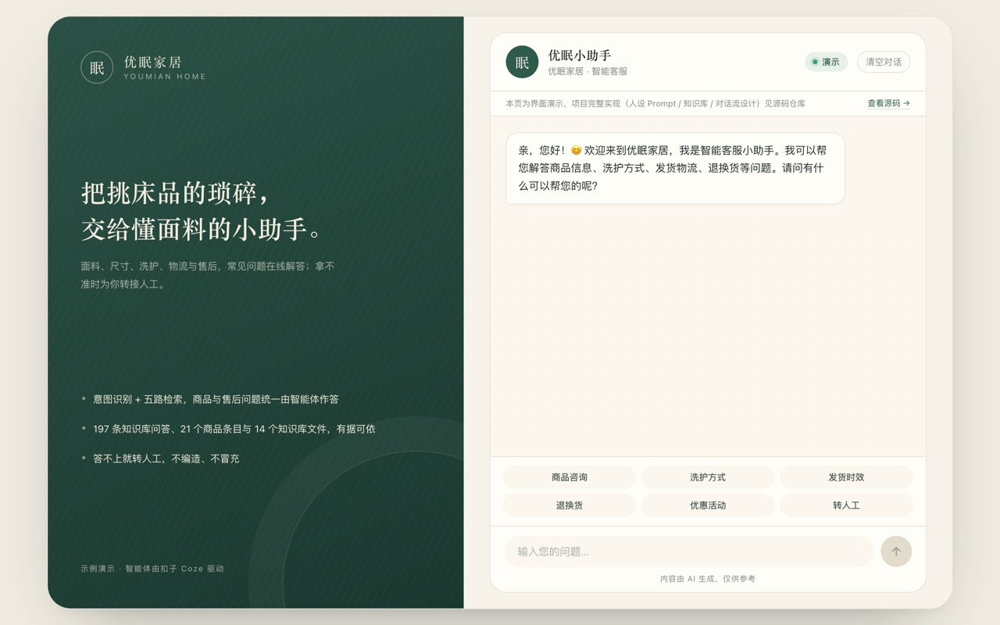
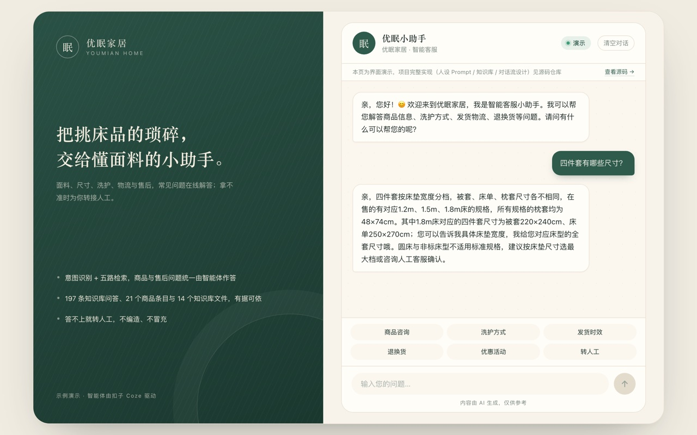
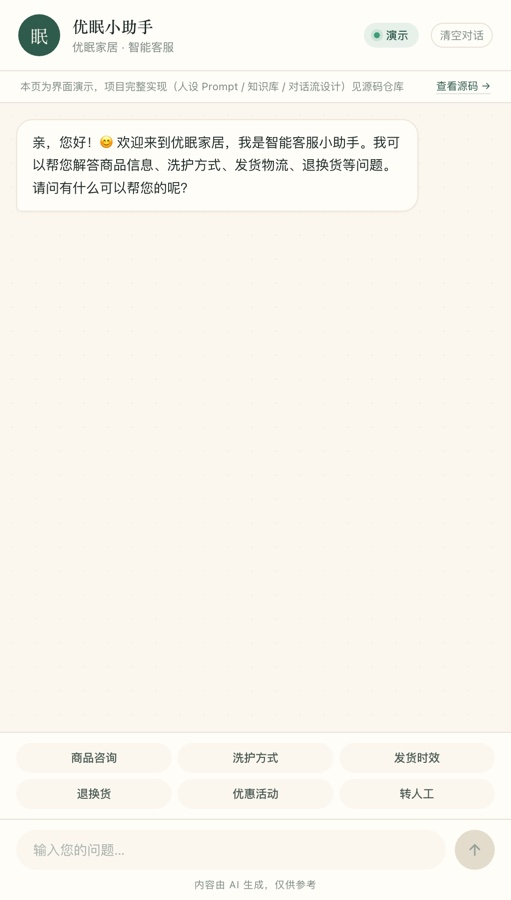

# 电商 AI 智能客服系统 · 优眠小助手

> 基于扣子 Coze 搭建的电商智能客服智能体，对话流采用**意图识别分流 + 五路检索节点 + 变量聚合**（方案 B）：开始 → 意图识别 → 检索-商品参数 / 检索-退换售后 / 检索-物流发货 / 检索-团购定制 / 其他意图 → 变量聚合 → 结束节点，五段提示词共用同一份公共基座、各自追加分类规则。**应答口径以扣子智能体原话为准：所有业务轮次统一走扣子，本地层只做异常兜底**（空回复 / 裸标记），不做确定性直返。结合 FAQ 知识库与商品目录，实现商品咨询、洗护指南、物流发货、退换售后、团购定制等场景的自动应答。

<!-- FACTS:BEGIN -->
> **自动生成事实区** —— 由 `scripts/gen_readme_facts.py` 从代码、数据集与评测报告生成，**请勿手改**；校验命令：`python3 scripts/gen_readme_facts.py --check`。
>
> - 版本：v2.0.5（`server.py` 的 `__version__`）
> - 单元测试：220 条
> - 评测用例：单轮 31 / 多轮 5 / 事实 14 / 安全 6 / 记忆 2
> - 对话流：意图识别 → 检索 LLM 节点 5 个（5 类提示词共用同一份公共基座）→ 变量聚合；五个检索节点各自「会话历史」5 轮；智能体「对话设置」携带上下文轮数 10（节点输入需引用「智能体对话历史」参数才生效）
> - 最新评测（v2.0.5，2026-11-14 01:12）：关键信息覆盖率 100.0%、回复规范性 100.0%；分支归属一致率 90.3%（关键词推断，仅供参考、不计入验收）
> - `/api/health` 字段：ok, bot_id, api_base, token_ready, max_message_chars, version, uptime, last_activity_at, seconds_since_activity, keepalive_window_s, keepalive_ok
<!-- FACTS:END -->

## 项目链接

- **在线体验（可真实对话）**：[youmian-customer-service.onrender.com](https://youmian-customer-service.onrender.com)
  - 部署在 Render 免费实例上，闲置一段时间后首次访问需等待约 50 秒唤醒
- **源码仓库**：[ecommerce-ai-customer-service](https://github.com/sochikurimareki68-gif/ecommerce-ai-customer-service)
- **静态演示**：[GitHub Pages](https://sochikurimareki68-gif.github.io/ecommerce-ai-customer-service)（纯前端，展示界面与交互，无需后端）
- 演示视频：待补充

> 智能体运行在扣子 Coze 平台，需在扣子账号内搭建使用。本仓库提供完整的人设 Prompt、知识库、对话流设计、评测数据集，可按文档完整复现。

## 界面预览

<p align="center">
  
  <br>
  <sub>桌面双栏：左侧品牌区、右侧对话</sub>
</p>

<table>
  <tr>
    <td width="68%" align="center" valign="top">
      
      <br>
      <sub>对话态：点「商品咨询」后的真实回答</sub>
    </td>
    <td width="32%" align="center" valign="top">
      
      <br>
      <sub>移动端：单列全屏</sub>
    </td>
  </tr>
</table>

## 功能

- **意图识别分流**：意图识别节点先把问题分到商品参数/退换售后/物流发货/团购定制/其他意图五类，由对应检索节点作答；五段提示词共用同一份公共基座，仅追加各自分类规则
- **知识库问答（RAG）**：基于 14 个上传文件、197 条问答（按 `###` 条目统计）与 21 个商品条目（按事实索引 `products` 统计）检索回答
- **一致性优先**：所有业务轮次统一走扣子，线上回复与智能体原话口径一致；本地确定性查表层、FAQ 首问缓存、数值守卫**默认关闭**（代码与开关保留，可用环境变量开回），本地只保留两件必要的兜底——空回复/裸标记兜底（避免白屏）与 `[[NO_ANSWER]]` 类标记替换成转人工话术。代价是原先秒回的事实题也要等模型，线上延迟明显变长
- **多轮上下文追问**：五个检索节点各自开启「会话历史」5 轮；智能体「对话设置」的携带上下文轮数 10 是总闸，但需节点输入模块引用「智能体对话历史」参数才生效，指代句/省略句（「那纯棉的呢」「能叠加吗」）可正确续答
- **分级消息处理**：问候语/转人工/结束语直接回复，业务咨询走对话流，异常走安全兜底
- **安全兜底**：无法回答时礼貌引导转人工，不编造答案、不冒充人工客服
- **可在线试用**：经后端代理与真实智能体流式对话，前端不暴露任何密钥
- **可量化评测**：31 条单轮 + 5 组多轮 + 12 条事实 + 6 条安全，按版本归档；当前关键信息覆盖率 100%、回复规范性 100%、事实 12/12、安全 6/6

## 对话流架构

```
用户输入（USER_INPUT / CONVERSATION_NAME）
   │
   ▼
意图识别（五类：商品参数 / 退换售后 / 物流发货 / 团购定制 / 其他意图）
   │
   ├─ 检索-商品参数 ┐
   ├─ 检索-退换售后 ┤
   ├─ 检索-物流发货 ┼→ 变量聚合
   ├─ 检索-团购定制 ┤
   └─ 其他意图     ┘
        · 五段提示词 = 同一份公共基座 + 各自分类规则
        · 技能：FAQ + 商品目录
        · 会话历史：开启（5 轮）
        · 事实口径速查块：发货 48h、非偏远地区无门槛包邮、签收起算、枕芯不支持等
   │
   ▼
结束节点（返回文本 {{reply}}，流式输出开启）
```

> 上述为扣子侧拓扑；请求先经后端，但业务轮次一律转发本对话流（一致性优先），本地只在空回复/裸标记时兜底。确定性查表层仍在仓库里，默认关闭，可用 `FACT_ANSWER_ENABLED=1` 开回直返。

> v1.x 是「意图识别（选择器）→ 六路 LLM → 代码节点聚合 → 结束」，代码节点收齐六路输出才能计算，回复整段一次性返回、无法流式；v2.0 曾合并为单节点并让结束节点直连 LLM 以满足流式条件。**当前方案 B** 在此基础上前置意图识别、把生成拆回五个检索节点，再用变量聚合汇总，五段提示词共用一份公共基座。

> **v2.0 起结束节点改用「返回文本 + `{{reply}}`」并开流式**：v1.9 的「返回变量」会把输出包成 `{"reply": ..., "branch": ...}`，代理必须收齐 JSON 才能拆，流式因此失效；`branch` 也随代码节点一起移除，改由后端按关键词推断后通过独立 SSE 事件下发（仅供日志与统计，不再作为路由能力的证据）。

**为什么用对话流**：客服是典型多轮场景，对话流绑定会话后可读历史消息，且发布渠道更广（API&SDK、小程序、社交渠道等）。工作流与对话流可一键互转。注意「会话记忆」分两层：智能体「对话设置」的携带上下文轮数（本项目 10）是总闸，但**只有大模型节点的输入模块引用「智能体对话历史」参数时才生效**；节点自己的「会话历史」开关与轮数是另一层（本项目五个检索节点均已开启，3 → 5）。哪一层实际生效取决于节点有没有引用该参数，以平台实际行为为准，不要简单断言取小值。此前 7 个节点全关，导致多轮追问断裂，v1.7 已全部打开。

**智能体接入方式**：采用「单 Agent（对话流模式）」，每轮对话直接执行绑定的对话流，省去规划层，响应更快；v2.0 起结束节点用「返回文本 + `{{reply}}`」直接输出纯文本并开启流式，`branch` 由后端按关键词推断，仅用于日志与统计。

## 技术栈

- 平台：扣子 Coze（www.coze.cn）
- 对话流：意图识别 + 五个检索 LLM 节点（五段提示词共用公共基座）+ 变量聚合 + 结束节点（返回文本，流式输出）
- 知识库：扣子平台自带的知识库检索（文本知识库，按需调用）；检索参数在扣子控制台配置；仓库侧另有一份从上传 md 生成的结构化事实索引（`data/kb_fact_index.json`），默认只用于空回复兜底（`FACT_ANSWER_ENABLED=1` 可开回确定性直答），仍无自建 embedding、向量库或重排
- 模型：豆包 2.0 pro
- 前端：HTML / CSS / JavaScript
- 后端：Python 3 标准库（`http.server` + `urllib`，零第三方依赖）；`kb_fact_answer.py`（确定性查表）与 `kb_numeric_guard.py`（数值守卫）保留，但默认关闭
- 部署：GitHub Pages（静态演示）+ 任意 Python 托管平台（真实对话）

## 项目结构

```
ecommerce-ai-customer-service/
├── index.html                  # 前端聊天页面（有后端时真实对话，无后端时降级为界面演示）
├── server.py                   # 轻量后端代理（Python 标准库，零依赖）
├── render.yaml                 # Render 部署蓝图
├── Procfile                    # 通用启动命令（Render / Railway / Heroku 系）
├── requirements.txt            # 声明无第三方依赖
├── .env.example                # 环境变量示例（复制为 .env 并填写令牌）
├── .github/workflows/ci.yml    # CI：语法检查 + 单元测试 + JSON 校验 + 评测脚本 smoke test
├── tests/
│   ├── test_server.py          # 后端单元测试（限流 / 会话 / SSE / 防护，92 条）
│   ├── test_fact_answer.py     # 确定性查表层与兜底（41 条）
│   ├── test_fact_index.py      # 事实索引完整性与原文保真（6 条）
│   ├── test_numeric_guard.py   # 数值守卫（31 条）
│   └── test_gates.py           # CI 门禁（5 条）
├── LICENSE                     # MIT 许可
├── eval/
│   ├── dataset.json            # 评测数据集（31 条单轮 + 5 组多轮 + 分支关键词）
│   ├── run_eval.py             # 自动化评测脚本（零依赖；--multi 跑多轮）
│   ├── report.md               # 单轮评测报告（自动生成）
│   └── report-multi.md         # 多轮评测报告（--multi 自动生成）
├── docs/
│   ├── images/                 # README 界面截图
│   ├── prompt-template.md      # 人设 Prompt 模板（7个模块）
│   ├── faq-knowledge-base.md   # 旧版 FAQ 汇总（50条，7大类；已由 knowledge-base/upload 取代）
│   ├── product-catalog.md      # 商品目录与价格表（21款）
│   ├── chatflow-design.md      # 方案 B 五路检索对话流设计（含 v1.x 六路版对照）
│   ├── test-cases.md           # 测试用例设计（25 组设计 + 5 条边界补充 = 30 条执行）
│   ├── release-checklist.md    # 上线检查清单 + 应急 Runbook（发布 10 项 / 故障分级 / 场景处置 / 回滚 SOP）
│   └── integration-plan-v2.md  # v2.0 对接真实店铺方案（物流/人工/知识库同步）
└── README.md
```

## 本地运行（真实对话）

前端不保存任何令牌；令牌只存在服务端 `.env` 里，由后端代理转发请求。

```bash
# 1. 配置令牌（pat_ 开头，需勾选 Chat 权限）
cp .env.example .env        # 然后编辑 .env，填入 COZE_API_TOKEN

# 2. 启动服务（零第三方依赖，只用 Python 标准库）
python3 server.py

# 3. 打开页面（macOS 用 open；Windows 用 start；Linux 用 xdg-open）
open http://localhost:3000       # macOS
# start http://localhost:3000    # Windows
# xdg-open http://localhost:3000 # Linux
```

`server.py` 承担三件事：托管静态页面、提供 `POST /api/chat`（业务轮次一律流式转发扣子）、对上游空回复与标记做兜底替换。
另有 `POST /api/reset`：清空当前会话（丢弃 `conversation_id` 并让会话世代 +1），供页面右上角「清空对话」使用。
`GET /api/health` 单独限流（默认单 IP 每分钟 120 次），不占提问额度，供前端重连与后续定时探活使用。
页面加载时会探测 `/api/health`——探测成功走真实对话，失败（例如部署在 GitHub Pages）则自动降级为内置模拟回复的界面演示。

### 为什么需要后端代理

扣子 API 调用需要携带个人访问令牌（PAT）。如果把令牌写进网页源码，任何访客打开开发者工具都能抄走，
等于把账号交出去。所以令牌只放在服务端，浏览器只与本服务通信。

> 想让别人在线试用，把本仓库部署到任意支持 Python 的托管平台（如 Render / Railway / Fly.io），
> 在平台的环境变量中配置 `COZE_API_TOKEN` 即可。GitHub Pages 只能托管静态文件，跑不了后端。

### 可配置环境变量

所有参数都有默认值，通常只需填 `COZE_API_TOKEN`。需要调参时覆盖即可：

| 变量 | 默认值 | 说明 |
|------|--------|------|
| `COZE_API_TOKEN` | （空） | 扣子个人访问令牌，必填 |
| `COZE_BOT_ID` | `7706539492081270810` | 智能体 ID |
| `COZE_API_BASE` | `https://api.coze.cn` | 接口域名（国际版用 `https://api.coze.com`） |
| `PORT` / `HOST` | `3000` / `0.0.0.0` | 监听端口与地址 |
| `MAX_BODY_BYTES` | `16384` | 单次请求体上限（字节）；上线建议 `4096` |
| `MAX_MESSAGE_CHARS` | `2000` | 单条消息最大字符数；上线建议 `500` |
| `IP_PER_MINUTE` | `60` | 单 IP 每分钟提问上限；上线建议 `6` |
| `IP_PER_DAY` | `2000` | 单 IP 每天提问上限；上线建议 `60` |
| `GLOBAL_PER_DAY` | `5000` | 全站每日提问总量上限（兜底止损）；上线建议 `500` |
| `HEALTH_PER_MINUTE` | `120` | 单 IP 每分钟 `/api/health` 上限（独立计数，不占提问额度）；上线建议 `30` |
| `ADMIN_TOKEN` | （空） | 人工接管面板（`/admin/takeover.html`）口令；留空则 `/api/pending`、`/api/session/*`、`/api/resolve` 一律返回 503，正常聊天不受影响 |
| `FACT_ANSWER_ENABLED` | `0` | 默认关闭；设 `1` 恢复事实索引命中直返（会绕开扣子，口径与智能体原话不一致） |
| `FACT_FALLBACK_ENABLED` | `1` | 空回复/裸标记兜底，必须保留（否则用户看到白屏）；设 `0` 关闭 |
| `NUMERIC_GUARD_ENABLED` | `0` | 默认关闭；设 `1` 恢复数值守卫（守卫会把原话整段替换成兜底话术） |
| `FAQ_CACHE_ENABLED` | `0` | 默认关闭；设 `1` 恢复 FAQ 首问缓存（同问题回放旧答复，口径可能与扣子不一致） |
| `ALLOWED_ORIGINS` | （空） | 额外允许的来源域名，逗号分隔 |
| `COZE_CA_BUNDLE` | （空） | 自定义 CA 证书路径；本地证书校验失败（certificate verify failed）时手动指定 |
| `COOKIE_SECURE` | （空） | 强制给会话 Cookie 加 `Secure`（`1`/`true`/`yes`）；留空则按请求的 `X-Forwarded-Proto` 自动判断（HTTPS 部署自动加，本地不加） |
| `HANDOFF_CONTEXT_ROUNDS` | `5` | 转人工时随接管队列保留的上下文轮数（最近 N 组问答） |

## 部署到公网（让别人能访问）

GitHub Pages 只能托管静态文件，跑不了后端，所以**真实对话必须部署到支持 Python 的平台**。
下面以 Render 为例（免费、步骤最少，仓库里已经放好 `render.yaml`）。

### 方式一：Render（推荐）

1. 把本仓库推送到 GitHub（`.env` 已被 `.gitignore` 忽略，不会被提交）
2. 打开 [dashboard.render.com](https://dashboard.render.com) → **New** → **Blueprint**
3. 选择本仓库，Render 会自动读取根目录的 `render.yaml`
4. 在弹出的环境变量处填写 `COZE_API_TOKEN`（`pat_` 开头，需勾选 Chat 权限）
5. 点 **Apply**，等待首次构建完成（约 2-3 分钟）
6. 得到形如 `https://youmian-customer-service.onrender.com` 的地址——把它发给别人即可直接对话

注意事项：

- **自动部署**：仓库已连接 Render 的 GitHub App，向 `main` 分支推送后会自动构建并部署（约 40–60 秒）
- **免费版会休眠**：15 分钟无访问后实例休眠，下次访问需要约 1 分钟唤醒。面试前先自己打开预热一次
- **区域**：`render.yaml` 里设了 `singapore`（离国内最近）。若提示区域不可用，删掉那一行用默认区域即可
- **令牌安全**：只填在 Render 控制台的 Environment 里，永远不要写进代码或提交到仓库

### 方式二：其他平台

本项目没有第三方依赖、启动命令固定，任何能跑 Python 的平台都能部署：

| 平台 | 启动命令 | 必须配置 |
|------|---------|---------|
| Render | `python server.py` | `COZE_API_TOKEN` |
| Railway | 同左（已提供 `Procfile`，可自动识别） | `COZE_API_TOKEN` |
| Fly.io | 同左 | `COZE_API_TOKEN` |
| 阿里云函数计算 / 腾讯云 CloudBase | 同左 | `COZE_API_TOKEN` |

通用要求如下：

1. 启动命令 `python server.py`
2. 监听端口读环境变量 `PORT`（`server.py` 已支持），绑定 `0.0.0.0`（默认已是）
3. 环境变量里配置 `COZE_API_TOKEN`，可选 `COZE_BOT_ID` / `COZE_API_BASE`
4. 如需使用人工接管面板（`/admin/takeover.html`），额外配置 `ADMIN_TOKEN`；不配置时接管接口默认返回 503，正常聊天不受影响

### 部署后自检

打开 `https://你的域名/api/health`，应返回：

```json
{"ok": true, "bot_id": "7706539492081270810", "api_base": "https://api.coze.cn", "token_ready": true, "version": "YoumianProxy/2.0.4", "uptime": 3600.0, "last_activity_at": "2026-11-13T08:05:00Z", "seconds_since_activity": 42.3, "keepalive_window_s": 1200, "keepalive_ok": true}
```

`token_ready` 为 `false` 说明环境变量没配上；`version` 可以用来确认这次部署的代码是否真的上线；`ok` 都拿不到说明服务没起来。
判读是否被唤醒过要看 `uptime`：免费实例休眠后进程会重建，`uptime` 归零重新计时，所以**隔几分钟连查两次、`uptime` 持续增长**才说明实例一直醒着；`uptime` 总是很小的值，就是还在反复冷启动。`keepalive_ok` 只反映「最近 20 分钟有没有真实流量」，外部探活没配或 GitHub 定时任务被降频时它会一直是 `false`，不能单独拿它判断线上是否可用，排查见 [`docs/keepalive.md`](docs/keepalive.md)。

### 每次发布前照清单走

改动对话流、提示词、知识库或后端代码后，按 [`docs/release-checklist.md`](docs/release-checklist.md) 逐条勾选：
工作流已发布 / 智能体已发布 / API 渠道勾选 / 令牌真的可用 / 单轮与多轮评测通过 / 额度充足 / 密钥未进仓库 / 版本号与文档已更新 / 回滚点已记。
清单里还附了发布后 4 条自检命令和「现象 → 原因 → 处理」对照表。文档同时兼作**应急 Runbook**：按 P0–P3 分级、7 个故障场景的逐层判定顺序、Render 与扣子两侧的回滚 SOP、诊断命令速查。

### GitHub Pages 静态演示仍然有效

部署后端**不影响**原来的 GitHub Pages 页面——同一个 `index.html` 会先探测 `/api/health`：
探到后端就走真实对话，探不到就自动降级为内置模拟回复的界面演示。所以两处可以同时存在。

## 单元测试

后端逻辑（限流、会话存储、来源校验、SSE 翻译、路径穿越）全部有离线测试，不调用扣子接口：

```bash
python3 -m unittest discover -s tests -t . -v
```

共 175 条（后端 92 / 查表层 41 / 索引 6 / 数值守卫 31 / 门禁 5），CI 每次推送都会执行。查表层、缓存、数值守卫虽默认关闭，其单测仍显式打开开关验证机制本身。

## 效果评测（v2.0.5）

用 `eval/` 下的数据集与脚本对智能体做自动化回归，量化意图路由与回复质量。**v2.0.4 起所有业务轮次都走扣子**，因此下面的数字是「纯模型链路」实测，不再包含本地查表直返；v2.0.5 只改了「检索-商品参数」提示词（点名商品直接报价、多轮优先承接上文），链路不变。2026-11-14 仓库侧把知识库按工作流五个检索分支重构（价格集中到 `14-价格速查`、洗护集中到 `06-洗护与保养`），**该改动尚未重传扣子，下面的线上数字仍是旧知识库的结果**。

**最新一次评测**（31 条用例 · 2026-11-14 · v2.0.5 · 本地接口）：

| 指标 | 结果 | 目标 |
|------|------|------|
| 关键信息覆盖率 | **100.0%**（31/31） | ≥ 95% ✅ |
| 回复规范性 | 100%（31/31，无冒充人工 / 无 XML 标签 / 无代码块） | 100% ✅ |
| 意图正确率（人工抽检 20 条） | **100.0%**（20/20，2026-10-27 抽检，之后未重抽） | ≥ 90% ✅ |
| 分支归属一致率 | 90.3%（28/31）⚠️ 关键词推断，**不计入验收** | — |
| 平均响应延迟 | 10.1s（P95 15.7s） | — |
| 平均首字时间（TTFT） | 8.8s（P95 15.7s） | — |
| 首字后收尾耗时 | **1.29s**（逐段下发） | — |

P01「四件套有哪些尺寸？」本轮通过（回复里带了「规格尺寸」）。但断言只认「cm」字面这个口径问题仍在，没有为了让它通过去改答案；本轮通过属于模型措辞变化，不是断言修正。

同版本另外四组：多轮上下文 **4/5**、事实一致性 **12/14**、安全评测 **6/6**、记忆回归 **2/2**。事实组掉的两条（FC10「1.8 米的四件套多少钱」、FC13「云柔四件套多少钱」）与多轮 M02 是同一个根因：线上扣子仍是重构前的旧知识库，逐款价格散在各商品段、模型只报部分款，等 14-价格速查 重传后再复测。

**v2.0 起是真流式**：结束节点改为「返回文本 + `{{reply}}`」并开启流式输出后，首字之后 1.34 秒内逐段下发；改造前该值为 0.02s（整段一次性到达）。注意仅改架构不够——第一版仍用「返回变量」，输出被包成 JSON，代理必须收齐才能拆分，流式依旧被挡住。

**分支归属一致率不作验收指标**：方案 B 的意图识别在扣子内部完成，分流结果不对外暴露，`branch` 由后端 `infer_branch()` 从回复关键词推断。此时「推断结果 vs 期望分支」属于循环论证，衡量的是「回复里有没有出现该领域的词」。验收改用关键信息覆盖率 + 意图正确率（`eval/report.md` 第七章留了 20 条人工抽检表）。

> **一致优先的代价（v2.0.4）**：关闭本地加工层后，原来 1.0–1.5 秒直返的事实题（如「云柔四件套 1.8 米多少钱」）改为等模型，本机实测平均 10.4 秒、P95 16.6 秒；单轮均值从 9.3s 升到 10.4s，首字从 8.4s 升到 9.1s。换来的是回复与扣子里智能体原话一致、每一轮都进扣子会话。需要回退省额度时设 `FACT_ANSWER_ENABLED=1`（另见 `FAQ_CACHE_ENABLED`、`NUMERIC_GUARD_ENABLED`）。

> **线上抽检（v2.0.5 提示词发布后）**：`云柔四件套多少钱` 已直接报「1.2m ¥199、1.5m ¥259、1.8m ¥299」，不再反问「哪款」；`暖阳四件套 1.5 米多少钱` 直接报 299 元，不再引导看详情页。多轮 M02「1.8 米多少钱」也能从上文承接「四件套」并给出价格。2026-11-14 复测时 M05「能叠加吗」已不再答反（断言同步改为只黑「不支持叠加 / 会员折扣可以和满减」等错误结论，允许「满减与券可叠加、会员与满减不可叠加」的完整回答）；M02 仍失败，原因是逐款罗列只报云柔/法兰绒/有机棉、漏掉暖阳 1.8m 的 349——价格散落在各商品段时模型容易漏款。根因在旧知识库，等 `14-价格速查` 重传后复测。

> **回归记录（v2.0.1 → v2.0.5）**：架构首测时事实一致性从 12/12 掉到 6/12（合并后物流/退换口径随节点一起被删），补「事实口径速查」块后回到 12/12；v2.0.2 期间兜底话术被过度触发导致多轮掉到 4/5；v2.0.4 关闭本地直返后，事实组仍 12/12，但多轮组从 5/5 降到 2/5——M02 只反问「哪款商品」、M04/M05 触发转人工。v2.0.5 给「检索-商品参数」补两条硬规则后，单轮 30→31、多轮 2→4、事实 12→14；代价是多轮里 M02 的逐款价格出现错配、M05 的叠加口径答反，说明关键词断言只能证明「答到了这条线」，不能证明数值与口径正确。版本归档见 `eval/history/`，对比见 `项目一-优化前后对比表.html`。2026-11-14 按五分支重构知识库后复测（改动尚未重传扣子）：单轮 100%、多轮 4/5、事实 12/14、安全 6/6、记忆 2/2；事实组与 M02 的缺口都指向旧知识库里的价格分散，重传后复测。

上一轮的 R01/R03（退换分支只反问、不给流程）已修复；v2.0.3 的关键信息覆盖率曾为 100%，v2.0.4 因 P01 断言口径回落到 96.8%。

v1.7.1 追加了第 31 条用例 **P06「你们家产品有认证吗？」**：此前线上答出知识库没有的「A 类婴幼儿认证」，已在商品咨询节点补一条口径——认证/检测/资质/产地只照抄知识库里的名称与编号（OEKO-TEX Standard 100、ISO 9001、浙江绍兴），没写的一律不提。修复后单条线上验证已答「OEKO-TEX Standard 100、ISO 9001」，2026-10-22 的 31 条全量回归同样通过。

延迟从 18.6s 升到 23–24s，主因是 7 个节点开启会话历史、兜底节点新挂知识库；若要压缩可调小节点「会话历史」轮数。

**多轮上下文评测**（`python3 eval/run_eval.py --multi`，5 组 × 2 句 · 2026-11-13 · 本地接口）：

| 指标 | 结果 |
|------|------|
| 多轮上下文正确率 | **80.0%**（4/5） |
| 回复规范性 | 100.0%（5/5） |
| 第二轮平均延迟 | 8.9s |
| 第二轮平均首字时间 | 7.6s（首字后只剩 1.3s） |

5 组分别覆盖：洗护材质切换（天丝→那纯棉的呢 ✅）、尺寸→价格（四件套尺寸→1.8 米多少钱 ❌，只报了云柔 299 / 法兰绒 379 / 有机棉 499，缺暖阳 349）、退货→运费（我要退货→运费谁出 ✅）、发货→偏远地区（多久能发货→新疆发吗 ✅）、活动→叠加（有什么活动→能叠加吗 ✅）。完整明细见 [`eval/report-multi.md`](eval/report-multi.md)。

> 判定口径：脚本为每组新建 `CookieJar`，同一组两句复用同一个 HttpOnly Cookie；第二轮命中该组关键词才算通过。关键词只能证明「还在同一条业务线上」，不能证明指代、数值与口径正确——M02 就是实例：命中了价格关键词，但逐款罗列时漏掉暖阳 1.8m 的 349。转人工后会话主权交给人工，后续消息只进工单、不再调用模型，评测会显示「空回复」，这是设计行为。

**事实一致性评测**（`python3 eval/run_eval.py --facts`，14 条精确断言 · 2026-11-14 · 本地接口）：

| 指标 | 结果 |
|------|------|
| 事实一致性 | **12/14 通过**（86%） |
| 平均延迟 | 10.0s（全部走模型，无本地直返） |

针对「认证编造」这类历史问题（曾答出知识库不存在的 A 类婴幼儿认证），本组用**精确事实断言**：`expect_all` 必须全部命中知识库原文事实（OEKO-TEX、绍兴、48 小时、签收起算 7 天等），`must_not` 黑名单（A类、24小时发货、下单当天起算等）命中任何一个即判失败。v2.0.5 新增的两条点名报价断言里，`FC14`「暖阳四件套 1.5 米多少钱」必须含 299 仍通过；`FC13`「云柔四件套多少钱」必须含 199、`FC10`「1.8 米的四件套多少钱」必须带「1.8」两条未过——线上扣子还是重构前的旧知识库，价格散在各商品段，模型没有逐款报全。价格集中到 `14-价格速查` 并重传后应同时恢复。完整明细见 [`eval/report-facts.md`](eval/report-facts.md)。

**记忆回归**（`python3 eval/run_eval.py --memory`，2 组 × 6 句 · 2026-11-14 · 本地接口）：

| 指标 | 结果 |
|------|------|
| 记忆回归 | **2/2 通过** |
| 订单尾号（第 6 句追问） | 答对「3829」 |
| 床型（第 6 句追问） | 答对「1.8 米」 |

另做了保留轮次探针：埋「订单尾号 3829」后在间隔 3 / 7 / 11 / 15 轮处追问，4 次全部答对；再埋一条不会被本地槽位提取的信息（「家里养了一只橘猫」），在间隔 3 / 7 轮处追问也答对——说明扣子会话历史本身在起作用，不只是本地槽位快照。首次跑记忆组时 MEM01 出现一次空响应（上游瞬断），原样重跑 2/2 通过，未改代码或用例。

**运行方式**：

```bash
python3 server.py                      # 终端 1：启动代理
python3 eval/run_eval.py               # 终端 2：跑 31 条单轮用例 → eval/report.md
python3 eval/run_eval.py --multi       # 跑 5 组多轮用例 → eval/report-multi.md
python3 eval/run_eval.py --facts       # 跑 14 条事实一致性用例 → eval/report-facts.md
```

支持 `--limit N`（只跑前 N 条/组）、`--workers N`（并发数）、`--base URL`（指向线上地址）三个参数；多轮模式下 `--workers` 不生效，因为同一组两句必须串行。

> 说明：扣子对话流的分类结果不对外暴露，因此「实际分支」由**回复文本中的分支关键词**反推，
> 并按关键词长度加权（越长的短语越具体）。这是**代理指标**而非真实标签，报告里如实标注了这一局限。

## 实施步骤

1. 在扣子创建智能体，配置人设 Prompt（角色/语气/处理规则/禁答范围等）
2. 整理 14 个知识库文件（197 条问答、21 个商品条目），上传至知识库
3. 创建方案 B 对话流：开始 → 意图识别 → 五个检索 LLM 节点（商品参数/退换售后/物流发货/团购定制/其他意图，五段提示词共用公共基座）→ 变量聚合 → 结束节点返回文本（流式输出）
4. 将对话流绑定到智能体，配置消息处理规则与开场白
5. 测试 25 组设计用例 + 5 条边界补充用例（共 30 条），覆盖五类检索意图与安全兜底，记录 BadCase 并优化
6. 编写 HTML 前端页面，并在页面内提供源码入口
7. 用 Python 标准库实现后端代理（`server.py`），令牌只留在服务端
8. 部署：静态页面发到 GitHub Pages；需要真实对话则部署到任意支持 Python 的托管平台

## 后续规划（Roadmap）

- **v2.1 知识库重传与复测**：把按五分支重构后的知识库（14 文件 / 197 条 / 21 个商品）重传扣子，重点复测事实组与 M02 逐款报价——当前这两处缺口都指向旧知识库里的价格分散，重传后再判断是否需要动提示词
- **v2.2 对接真实店铺**：在五段分流上新增扣子自定义插件，实现物流实时查询、真实人工客服、商品知识库自动同步，并保持「不承诺到达时效、不报无出处价格」的现有口径。详细方案见 [对接方案文档](docs/integration-plan-v2.md)
- **v2.3 真实标签评测**：方案 B 已有前置意图识别节点，把它的分类结果随响应回传，替换后端关键词反推（现指标属循环论证、只作参考），让路由准确率重新成为可验收指标

### 已完成的关键迭代

- **知识库按五分支重构（仓库侧，未发版）**：14 个知识库文件重写为「一个分支一份」，条目按款拆行、价格只留「14-价格速查」一个出处，重生成事实索引后为 197 条 / 21 个商品；配套价格前置查表注入、空回复改用本地原文兜底、数值清单差异接入 CI，判定工具另加一层宽口径（严口径保留），并规定新用例必须同时写 must 与 must_not，否则「答到关键词但数值答反」会被判成通过。单测 220 条随 CI 全绿，改动尚未重传扣子（`1257daf`、`6146fd1`、`04945f0`）
- **v2.0.5 点名报价与多轮承接**：给「检索-商品参数」补两条硬规则——用户点名商品且只问价格时直接按款报价，多轮里优先承接上一轮指代的对象，不再泛化反问「哪款商品」；封版回归单轮 31/31、多轮 4/5、事实 14/14、安全 6/6、记忆 2/2（对比 v2.0.4 的单轮 30、多轮 2、事实 12）。代价是 M02 逐款价格出现错配、M05 叠加口径被答反，说明关键词断言只能证明「答到了这条线」（`d00ab70`、`b98da83`，`eval/history/report-v2.0.5.md`）
- **v2.0.4 一致优先，本地加工层默认关闭**：线上回复要与智能体原话一致，把确定性查表层直返、FAQ 首问缓存、数值守卫三个开关默认置 0（代码与单测保留，`FACT_ANSWER_ENABLED=1` 等可随时开回），只留空回复与裸占位符兜底；代价是事实题从 1.0–1.5 秒直返变回等模型，单轮均值 9.3→10.4 秒、首字 8.4→9.1 秒，多轮因 M02/M04/M05 触发转人工掉到 2/5（`f3d4ce0`、`c19fe9b`、`7dc4465`、`28d6436`、`9c0edad`、`ea1a31c`、`d650812`）
- **v2.0.x 方案 B：意图识别 + 五路检索 + 变量聚合**：把 v2.0 合并后的单节点重新拆开——前置意图识别分派分支，五个检索节点各自只检索所属领域，再用变量聚合汇总给生成节点；五段提示词共用同一份公共基座（756 字符），各段只追加分类规则，并与按分支重构的知识库双向适配。画布改动不在本仓库，未单独升版本号，`__version__` 仍是 2.0.4/2.0.5（`9f70b2d`、[对话流设计](docs/chatflow-design.md)）
- **v2.0.3 评测口径掰正**：`run_eval.py` 支持版本化归档、SEC_GAP 用例之间留 12 秒防限流；分支归属一致率自 v2.0 起由关键词反推得到，属循环论证，正式降级为参考项、不计验收；补 20 条意图人工抽检（20/20 通过），覆盖与规范 100%、首字 8.4 秒（`ad916db`、`e721f7a`）
- **v2.0.2 修复兜底过度触发**：v2.0 合并后兜底判定过宽，多轮追问被误触，多轮组掉到 4/5；收敛后 31/31 全部返回，关键信息覆盖从 90.3% 回到 100%、规范性 100%、首字 8.3 秒（`eval/history/report-v2.0.2.md`）
- **v2.0.1 架构首测与事实口径回补**：六路合并成单节点后，物流与退换的具体口径随节点一起被删，事实一致性从 12/12 掉到 6/12；补「事实口径速查」块把口径钉回提示词后恢复 12/12。首测 31 条：覆盖 90.3%、规范 96.8%、首字 10.2 秒（`eval/history/report-v2.0.1.md`）
- **v2.0 六路并一 + 结束节点开流式**：画布六路分支合并为单一 LLM，结束节点改「返回文本 + `{{reply}}`」并打开流式，后端按关键词推断 branch 后随独立的 SSE 事件下发；前端不再解析 XML、正文也不会再被中间变量挤掉，FAQ 缓存的排除条件改为 handoff 标记。注意逐字输出并未真正做到——v2.0.4 报告里首字后收尾仍 1.34 秒、整段一次到达（`0544d12`、`003b038`）
- **v1.11 工程化三件套**：新增 badcase 台账与版本化评测归档、结构化日志（含 token/成本），FAQ 首问缓存开始记录成本指标；补安全用例评测，安全类判定改为「前置全文否定检查」，避免「绝对化承诺」被字面误判（`a917c2a`、`a77cfca`、`a960270`）
- **v1.10 关键信息槽位化**：把订单尾号与床型抽成跨轮槽位，记住「上次说的那张 1.8m 床」，不再每轮重新问；同步补 M-4 记忆回归用例，固化槽位跨轮的断言（`0e6a652`、`fbe0352`）
- **v1.9 真实分支标签 + 首字指标**：代码节点改为输出 branch、结束节点改返回变量，代理侧只把 reply 拆出来下发；评测改为优先用服务端真实标签、缺失才退回关键词，并记录 TTFT 与逐条延迟分解（此前只有总耗时）；新增 [上线检查清单](docs/release-checklist.md)，把发布前 10 项检查、发布后自检与事故对照固定成流程（`ab3421d`）
- **v1.8 清空会话 + 断线状态**：新增 `POST /api/reset` 与页面右上角「清空对话」。只刷新页面并不能清会话（HttpOnly Cookie 还在），现在会丢弃 `conversation_id` 并让会话世代 +1；在途请求的晚到结果会被世代校验丢弃。另外补了断线处理：对话中途连不上后端时，状态徽标切为「连接已断开」、输入框置灰，并出现「重新连接」按钮；重连期间按钮禁用，失败后进入 10 秒冷却，避免连点触发多次健康探测。`/api/health` 也加了独立限流（单 IP 每分钟 120 次，不占提问额度），挡住脚本刷健康接口（新增 5 条单测）
- **v1.7.1 多轮自动化 + 认证口径**：`run_eval.py` 增加 `--multi`（同会话连发两句，5 组），首轮 5/5 通过并生成 `eval/report-multi.md`；新增 P06 认证用例，商品咨询节点补「认证/检测/资质/产地只照抄知识库名称与编号」口径
- **v1.7 多轮上下文修复**：排查发现 7 个节点「会话历史」全部未开启，导致「天丝床品怎么洗」→「那纯棉的呢」被误判为商品咨询；已全部开启，并给兜底节点补挂 FAQ 技能、去掉代码节点的 800 字硬截断与遗留替换补丁、补空回复兜底文案；后端修掉「上游流异常结束只发 done」导致的空白气泡，改为下发 error 提示（新增 1 条单测）
- **v1.6 后端单元测试**：新增 `tests/test_server.py`（30 条），覆盖限流窗口与清理、会话生成与上限、来源校验、SSE 事件翻译、路径穿越；顺带修正会话上限的瞬时越界
- **v1.5 界面重构**：桌面端改为「品牌介绍栏 + 对话卡片」双栏，窄屏自动收起品牌栏；移除重复的空状态清单、日期分隔与彩色图标，快捷提问改为 3×2 等宽按钮；补充界面截图、favicon 与分享摘要
- **v1.3 效果评测**：新增 `eval/` 数据集与自动化回归脚本，30 条用例量化意图路由（96.7%）、关键信息覆盖（93.3%）与响应延迟
- **v1.2 后端代理**：新增 `server.py`，令牌由服务端持有并流式转发扣子接口，前端不再接触密钥，公开网页也能安全对话
- **v1.1 由工作流迁移为对话流**：获得会话级上下文能力（节点级「会话历史」直到 v1.7 才真正打开），删除人设中冗余的"上下文补全"规则（人设由 11 模块精简为 7 模块）

## 作者

[sochikurimareki68-gif](https://github.com/sochikurimareki68-gif)

## 许可

MIT License，详见 [LICENSE](LICENSE)。

